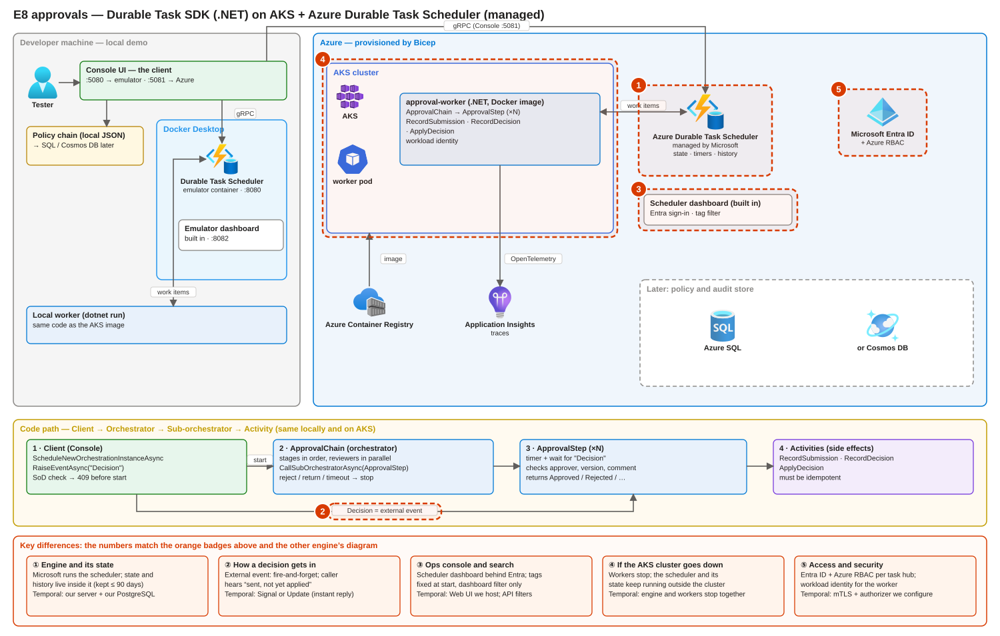
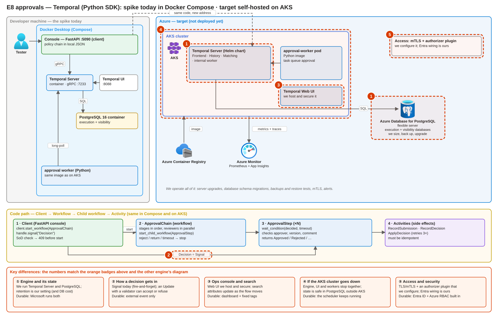

## What this spike is about

Prove that a standalone .NET Durable Task SDK worker can wait for a human
decision, survive worker replacement, and resume the **same approval instance**.
This uses the .NET SDK, not the Azure Functions runtime. `ApprovalChain`
coordinates saved policies; `ApprovalStep` handles each approval step.

A separate [Python Temporal spike](temporal/README.md) implements the same
approval pattern with self-hosted Temporal and PostgreSQL.

The test request is "Sunny Soda, plan version 3." We check:

* Approval after replacing the worker pod
* Explicit rejection (with a comment), return for changes, and no-response timeout: each ends
  the chain with no approval receipt
* One correlation ID and an Application Insights trace across the console and worker
* Refusal of the wrong approver, self-approval, and stale plan versions
* In-flight activity redelivery, demonstrating why business updates need deduplication
* Editing saved policies while existing runs keep their original chain and new runs pick up the edit
* One policy per client with a default chain for every business step and per-step overrides

## What runs where

The following locations describe the Durable baseline. The Temporal spike has
separate local services, shown in its architecture below.

| Location                    | Components                                                                                                                  |
| --------------------------- | --------------------------------------------------------------------------------------------------------------------------- |
| Azure, provisioned by Bicep | AKS with two fixed nodes, ACR, VNet/NAT egress, managed identities/RBAC, and Durable Task Scheduler with task hub `default` |
| AKS, deployed separately    | One containerized approval worker using workload identity                                                                   |
| Local machine               | Local Console UI/HTTP endpoints and optional CLI                                                                            |
| Local Docker Desktop        | Scheduler emulator and its dashboard, using task hub `approval-local`                                                       |

## Architecture

Both drawings preserve the supplied E8 architecture and its numbered difference
badges. Each shows the deployment boundaries and the code path from client to
approval chain, reviewer step and side-effect activities.

### Durable Task SDK on AKS with managed Scheduler

[Full-size drawing](architecture/E8-Durable-Task-AKS-Architecture.svg) |
[Editable draw.io source](architecture/E8-Durable-Task-AKS-Architecture.drawio)

Only the worker is deployed to AKS. The Local Console UI always runs locally.
Scheduler stores workflow state; the worker executes orchestrators and activities.
The dashed policy and audit stores are future application components, not
Scheduler persistence that we must provision.

### Self-hosted Temporal with an AKS target

[Full-size drawing](architecture/E8-Temporal-AKS-Architecture.svg) |
[Editable draw.io source](architecture/E8-Temporal-AKS-Architecture.drawio)

The left side shows the recorded Docker Compose deployment: FastAPI console,
Python worker, Temporal Server, PostgreSQL and Temporal Web UI. The right side
shows the AKS topology, now deployed with execution and visibility databases in Azure
Database for PostgreSQL Flexible Server outside the cluster. We still own
Temporal configuration, schema migrations, database sizing, access and recovery
qualification. PostgreSQL supports the spike's Visibility searches without
requiring Elasticsearch or OpenSearch.

## Key differences between Durable Task and Temporal

The first five rows correspond to the numbered badges in both drawings.
Platform capabilities are distinct from features enabled in these spikes.

| Area                        | Durable Task SDK + Azure Scheduler                                                                                           | Self-hosted Temporal                                                                                                                               |
| --------------------------- | ---------------------------------------------------------------------------------------------------------------------------- | -------------------------------------------------------------------------------------------------------------------------------------------------- |
| 1. Engine and state         | Microsoft operates Scheduler, durable history, timers and dispatch; we run application workers                               | We operate Temporal and provide execution and visibility databases                                                                                 |
| 2. Sending decisions        | External events; acknowledgement does not mean the decision has been applied                                                 | Signals in this spike have the same asynchronous acknowledgement; Updates can validate and return a processed result, but are not implemented here |
| 3. Operations and search    | Managed dashboard with immutable start-tag filters; the pinned SDK query lacks tag filtering, so the console scans instances | We host the Web UI; mutable typed Search Attributes support combined, paginated Visibility queries                                                 |
| 4. AKS failure boundary     | Workers stop during a cluster outage; Scheduler and its state are outside AKS                                                | In the target topology, server, UI and workers stop with AKS; external PostgreSQL has a separate availability boundary                             |
| 5. Identity and access      | Entra ID, task-hub Azure RBAC and AKS Workload Identity                                                                      | We configure TLS/mTLS, authorization and Web UI sign-in; production identity is not set up in the local spike                                      |
| Supported languages         | C#/.NET, Python and Java; JavaScript/TypeScript (preview); Go (beta)                                                          | C#/.NET, Go, Java, PHP, Python, Ruby, Rust and TypeScript/JavaScript                                                                                 |
| Workflow code upgrades      | Context-based versioning and worker matching are supported, but not configured or qualified here                             | Patching and Worker Deployment Versioning are supported, but in-flight code upgrades are not qualified here                                        |
| Testing and replay          | Mocked orchestration tests and recorded AKS acceptance checks                                                                | Real-server tests and replay of Approved, Rejected and Returned histories recorded locally                                                         |
| Observability               | OpenTelemetry traces to Application Insights, demonstrated in Azure                                                          | Structured logs and Temporal history; optional OTLP tracing; Jaeger removed and no trace exporter currently configured                               |
| History and business audit  | Service/SKU retention limits apply; a separate business audit store is needed                                                | Namespace retention is configurable; a separate business audit store is still needed                                                               |
| Cost and portability        | Scheduler charges plus worker infrastructure; this backend is Azure-hosted                                                   | MIT-licensed engine, but server, database and operations are not free; self-hosting is portable beyond Azure                                       |

Both engines support sequential and parallel approvals, durable waits and policy
snapshots. A business workflow designer, governed draft/test/publish lifecycle,
approver inbox, notifications, immutable audit store and duplicate-safe business
writes remain application responsibilities. Activating a new policy for future
runs is not the same as migrating an active workflow or safely changing its code.

See the [detailed platform comparison](DURABLE-SDK-VS-TEMPORAL.md) for evidence,
SDK-specific constraints and remaining qualifications.

## Start here

| Guide                                             | Use it for                                                                              |
| ------------------------------------------------- | --------------------------------------------------------------------------------------- |
| [Demo and tests](spike/README.md)                 | Local emulator demo, local-to-Azure demo, HTTP requests, dashboards, and pass checks    |
| [Source code](src/README.md)                      | Project map, build/test commands, HTTP/CLI interfaces, and worker image deployment      |
| [Azure infrastructure](infra/README.md)           | Bicep provisioning, access configuration, costs, and cleanup                            |
| [HTTP requests](approvals.http)                   | Start an approval, send a decision, and inspect its status/history                      |
| [Saved policies](approval_policies/README.md)     | Local policy storage, automatic activation, and version selection                       |
| [Temporal approval spike](temporal/README.md)     | Docker Desktop and AKS deployment with managed PostgreSQL, private UI access and verification |
| [Platform comparison](DURABLE-SDK-VS-TEMPORAL.md) | Architecture, authoring, search, versioning and recorded comparison findings            |

## Demo pages

| URL                                                           | What you see                                                       |
| ------------------------------------------------------------- | ------------------------------------------------------------------ |
| <http://localhost:5080>                                       | Local Console UI connected to the local emulator                   |
| <http://localhost:8082>                                       | Microsoft's local Scheduler dashboard                              |
| <http://localhost:5081>                                       | Local Console UI connected to Azure Scheduler and the AKS worker   |
| The console's **Open Scheduler dashboard** link in Azure mode | Microsoft's Azure dashboard, using your Entra sign-in              |
| <http://127.0.0.1:5090>                                       | Separate Temporal approval console                                 |
| <http://127.0.0.1:8088>                                       | Self-hosted Temporal Web UI                                        |
| <http://127.0.0.1:5091>                                       | AKS Temporal approval console through loopback port-forward        |
| <http://127.0.0.1:8089>                                       | AKS Temporal Web UI through loopback port-forward                   |

These URLs work after starting the services in the [demo guide](spike/README.md).
The local dashboard does **not** show Azure runs.
Temporal URLs require the separate [Temporal startup](temporal/README.md#start-or-stop).
AKS URLs require the [private access tunnels](temporal/README.md#access-the-aks-console-and-temporal-ui).

## Boundaries

This is a green-deployment spike, not a production approval service.
**Acting as** is simulated; `ApplyDecision` logs a stand-in receipt.
Policy setup is stored in a local JSON registry and snapshotted for each run.
Policies contain roles only; simulated user assignments live separately in
[demo identity settings](demo_settings/README.md).
Real identity binding, duplicate-safe destination updates, governed policy publishing,
Teams, audit storage, and production monitoring are not included.
